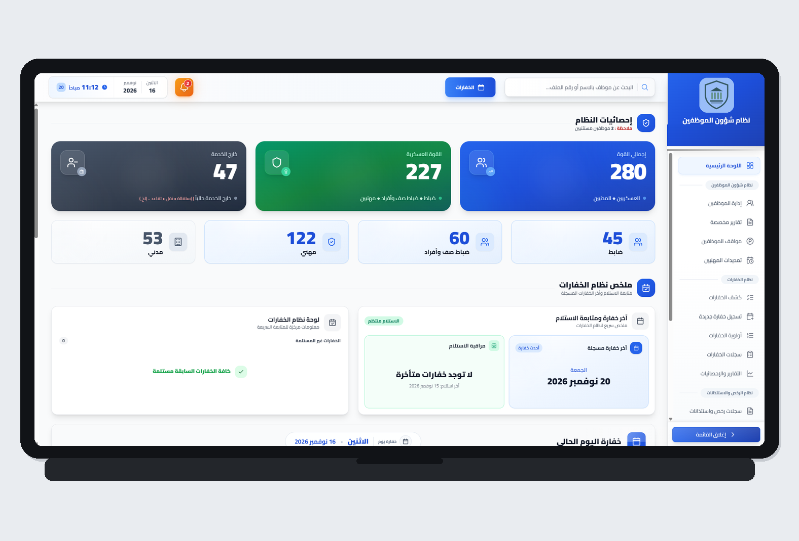
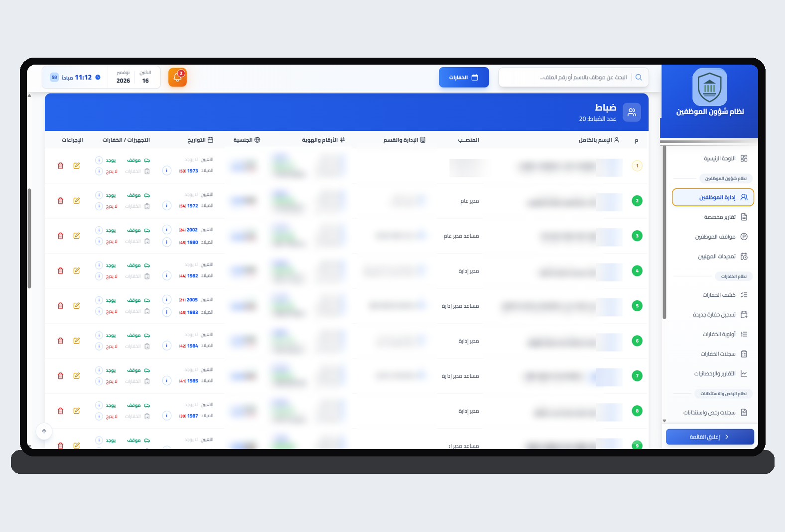
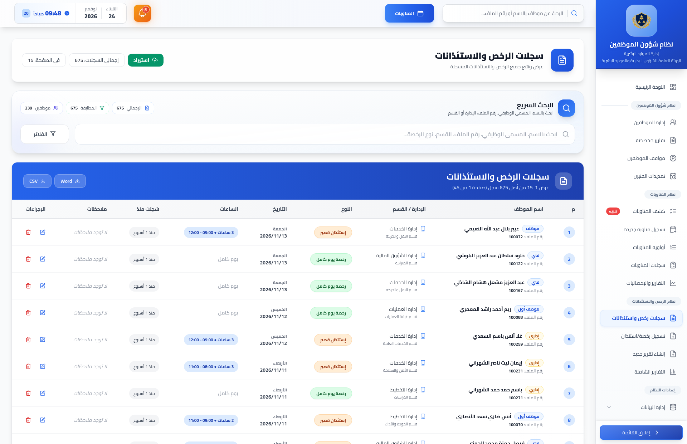
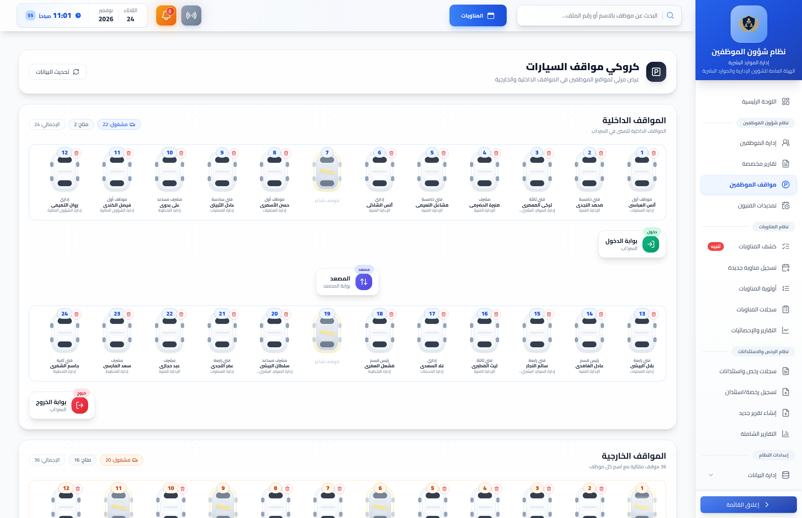

<div align="center">


# نظام إدارة الموارد البشرية وشؤون الموظفين

**Gov HR Suite — Unified HR, Duty Shifts, Licenses & Parking Management**

منصة واحدة تجمع العمليات اليومية لإدارة الموارد البشرية في جهة حكومية: سجلات الموظفين، الخفارات والمناوبات، الرخص والاستئذانات، ومواقف السيارات — في واجهة عربية كاملة الاتجاه (RTL) بدل الجداول الورقية والملفات المتفرقة.



</div>

> **نسخة عرض ببيانات وهمية بالكامل.** هذه نسخة مُنقّحة مخصصة للعرض المهني: كل الأسماء والأرقام والسجلات الظاهرة مُختلقة، والهوية البصرية عامة لا تخص أي جهة. الكود المعروض هو كود التطبيق الحقيقي بعد استبدال البيانات والهوية.

## المشكلة

بيانات الموظفين في جدول، وكشوف الخفارات في جدول آخر، ومتابعة الرخص على الورق، وتوزيع المواقف بالذاكرة. النتيجة: رخص تنتهي دون تنبيه، وتوزيع خفارات غير عادل، وساعات ضائعة في البحث عن سجل موظف واحد. هذا النظام يجمع كل ذلك في مكان واحد مع سجل تدقيق لكل تعديل.

## المزايا

- **إدارة الموظفين** — ملف كامل لكل موظف مع البيانات الأساسية (الإدارات، الرتب، المسميات، الجنسيات، المناصب، الأقسام)، وتمديدات الخدمة، واستيراد البيانات.
- **الخفارات والمناوبات** — تسجيل خفارات صباحية ومسائية وليلية، عرض أسبوعي، وسجل خفارات لكل موظف.
- **طابور الخفارة التالي** — ترتيب تلقائي عادل حسب الأقدمية منذ آخر خفارة، مع استبعاد الموظفين في إجازة.
- **الرخص والاستئذانات** — سجلات الرخص والاستئذانات مع تتبع الانتهاء وتنبيهات تلقائية قبل مواعيد التجديد.
- **خريطة مواقف تفاعلية** — مخطط بصري للمواقف بالمناطق وحالات الإشغال، وإعادة توزيع بالسحب والإفلات.
- **منشئ التقارير** — تقارير موظفين وعمليات قابلة للتهيئة مع تصدير الملفات.
- **سجل التدقيق** — كل إنشاء وتعديل واعتماد موثق بالمستخدم والوقت.
- **التنبيهات والإشعارات** — تنبيهات قابلة للتهيئة للانتهاءات والاعتمادات المعلقة وتغييرات الجداول.
- **واجهة عربية أولاً** — مصممة للعربية من الأساس بخط Cairo واتجاه RTL كامل وتصميم لوحات مسطح وأنيق.

## لقطات من التطبيق الحقيقي

### إدارة الموظفين — سجلات قابلة للبحث مع الحالة والتعيينات



### الرخص والاستئذانات — متابعة السجلات والانتهاءات



### خريطة المواقف — شبكة مناطق تفاعلية مع الإشغال والتوزيعات الأخيرة



> اللقطات من التطبيق الحقيقي أثناء التشغيل، مع طمس كل البيانات الشخصية وأسماء الإدارات والرتب والشعارات.

## التقنيات

- **الواجهة** — React + Vite + TypeScript، خط Cairo، RTL عربي كامل
- **الخادم** — Express (Node.js) بواجهات REST
- **قاعدة البيانات** — SQLite (ملف محلي واحد للبيانات الأساسية والمعاملات)
- **سطح المكتب** — غلاف Electron لنسخة قابلة للتثبيت بجانب نسخة الويب

## البنية

تطبيق معياري بنشر واحد: واجهة React منظمة بوحدات نطاق (الموظفون، الخفارات، الرخص، المواقف، التقارير)، وطبقة API رفيعة بـ Express، وقاعدة SQLite واحدة. طبقة وسيطة لسجل التدقيق تلتف حول كل عمليات الكتابة، وهي ما يغذي شاشة النشاط في لوحة التحكم. يُحسب طابور الخفارة من سجل الخفارات لحظة القراءة، فيبقى محدثاً دائماً دون مهام مجدولة منفصلة. مجلد `licenses system` يحتوي نسخة مستقلة أقدم من وحدة الرخص بسجل JSON.

## التشغيل محلياً

```bash
npm install
npm run dev          # الواجهة على المنفذ 5180
npm run backend      # الخادم (Express + SQLite)
```

## الحالة

نسخة عرض للملف المهني. النظام الأصلي مستخدم يومياً داخلياً؛ هذه النسخة العامة تحتوي الكود بعد التنقيح وبيانات وهمية فقط.
