<div align="center">


# Human Resources & Employee Affairs Management System

**Gov HR Suite — Unified HR, Duty Shifts, Licenses & Parking Management**

One platform that brings together the daily HR operations of a government entity: employee records, duty shifts and rotations, licenses and leave permits, and car parking — in a fully Arabic, right-to-left (RTL) interface, instead of paper registers and scattered files.

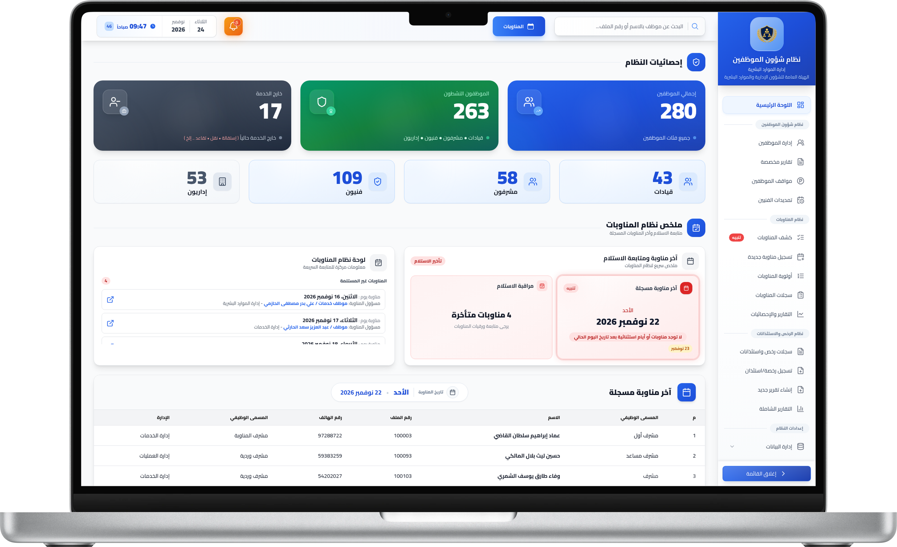

</div>

> **Showcase copy with fully fictional data.** This is a sanitised copy prepared for professional presentation: every name, number, and record shown is invented, and the visual identity is generic and does not belong to any entity. The code shown is the real application code, after replacing the data and branding.

## The Problem

Employee data in one spreadsheet, duty rosters in another spreadsheet, license tracking on paper, and parking allocation done from memory. The result: licenses expiring without warning, unfair duty distribution, and hours wasted searching for a single employee's record. This system brings all of that into one place, with an audit log for every change.

## Features

- **Employee Management** — a complete file for every employee with the master data (departments, job titles, grades, nationalities, positions, sections), service extensions, and data import.
- **Duty Shifts & Rotations** — morning, evening, and night duty registration, a weekly view, and a duty history for every employee.
- **Next Duty Queue** — fair automatic ordering by seniority since the last duty, excluding employees on leave.
- **Licenses & Leave Permits** — license and permit records with expiry tracking and automatic alerts before renewal dates.
- **Interactive Parking Map** — a visual parking layout by zones with occupancy states, and drag-and-drop reallocation.
- **Report Builder** — configurable employee and operations reports with file export.
- **Audit Log** — every create, update, and approval documented with the user and the time.
- **Alerts & Notifications** — configurable alerts for expiries, pending approvals, and schedule changes.
- **Arabic-first Interface** — designed for Arabic from the ground up, with the Cairo font, full RTL direction, and a flat, elegant dashboard design.
- **Mobile Experience & Sync** — a dedicated phone shell with four tabs and a smart duty calendar, an installable PWA, and a built-in sync layer with conflict handling (see Mobile Experience below).

## Screenshots from the Real App

### Employee Management — searchable records with status and assignments

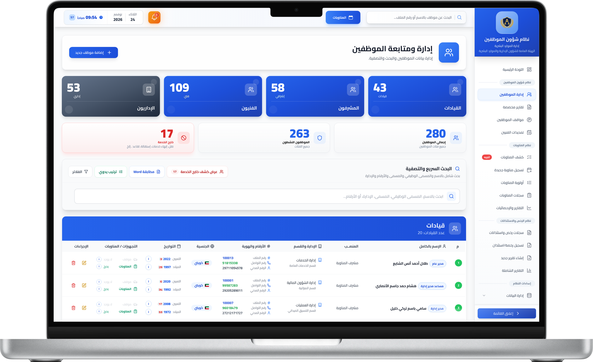

### Leadership — senior staff directory with job titles and assignments

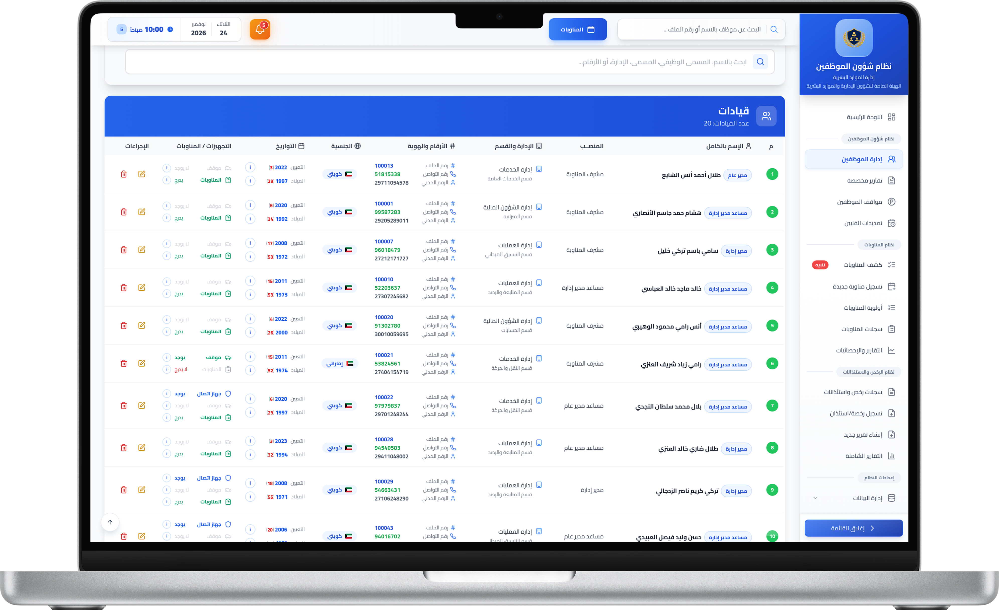

### Licenses & Leave Permits — record and expiry tracking

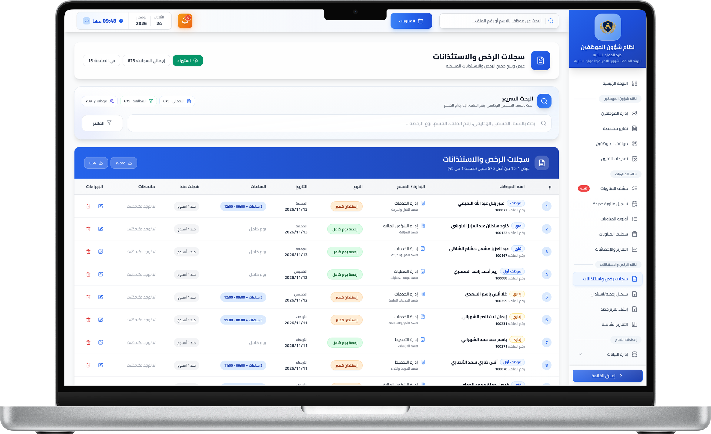

### Duty Shifts — rosters, handover tracking, and late-submission alerts

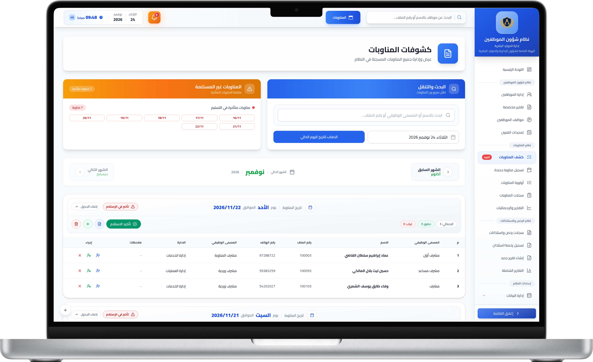

### Parking Map — interactive zone grid with occupancy and recent allocations

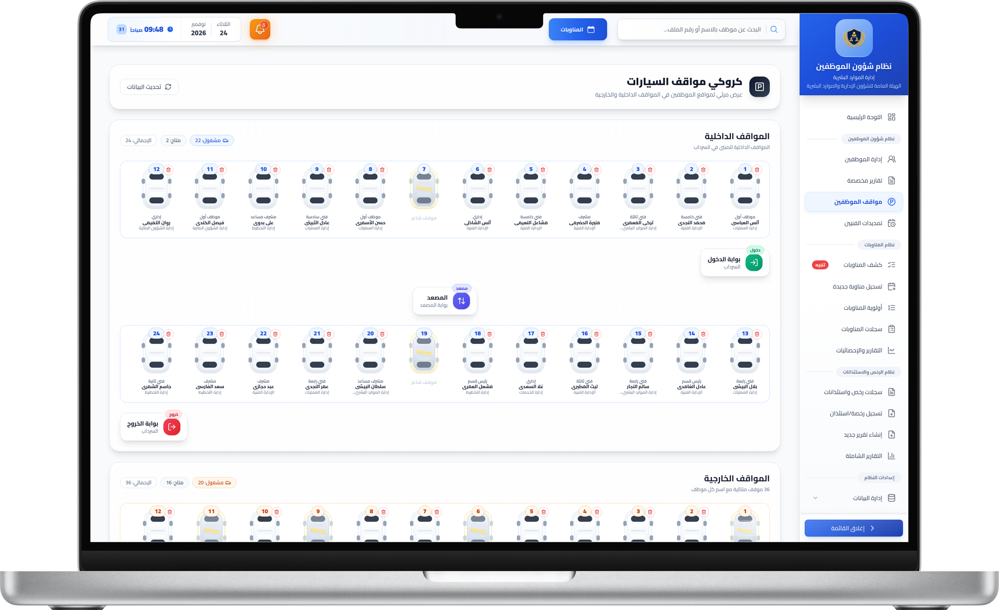

## Mobile Experience

The same system ships with a dedicated mobile experience: below a tablet breakpoint the interface switches to a purpose-built phone shell — not a squeezed desktop page — so the daily operations are one thumb away.

- **Four bottom tabs** — Home (smart search across name, job title, file number and civil ID, live workforce statistics, and this month's licenses), Employees (searchable directory with per-employee duty history), Shifts, and More.
- **Shifts, two ways** — a classic list view, or a **smart calendar** that lays the month out with per-day duty badges and attendance totals, with one-tap duty registration.
- **Everything else, scaled to fit** — the More tab carries a live **sync status card** (device identity, pending changes, conflicts, last sync, and a sync-now action) and opens every remaining desktop section — licenses, alerts, professional extensions, reports, parking, settings — in pages scaled to the phone's width.
- **Sync built in** — a device-to-cloud sync layer with a header sync badge, conflict resolution, and a PIN gate for the web build, so a phone and a desktop stay on the same data.
- **Installable PWA** — web app manifest, home-screen icons, and mobile web-app meta tags; install it and it runs full-screen like a native app.

### Home — statistics and smart search

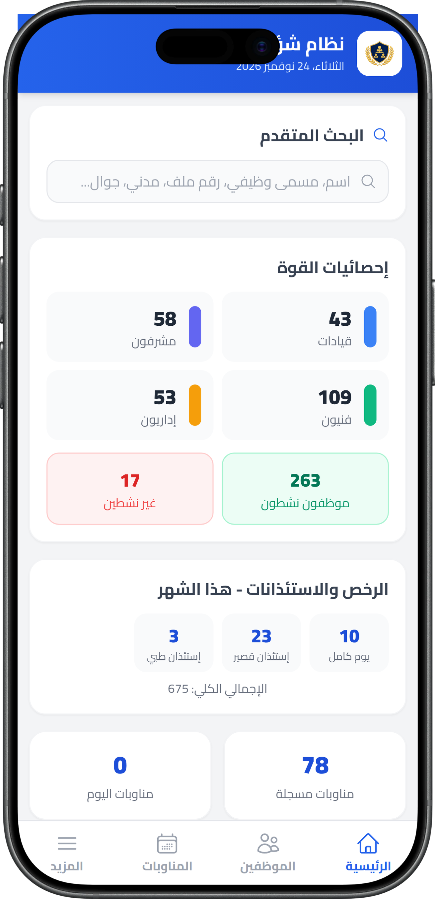

### Employees — directory with duty history

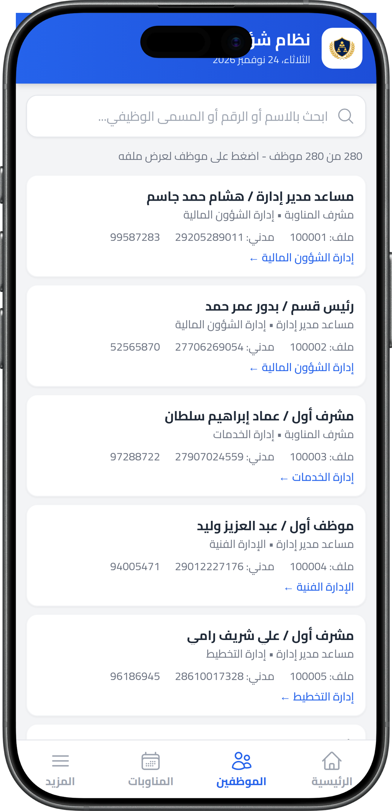

### Shifts — list view

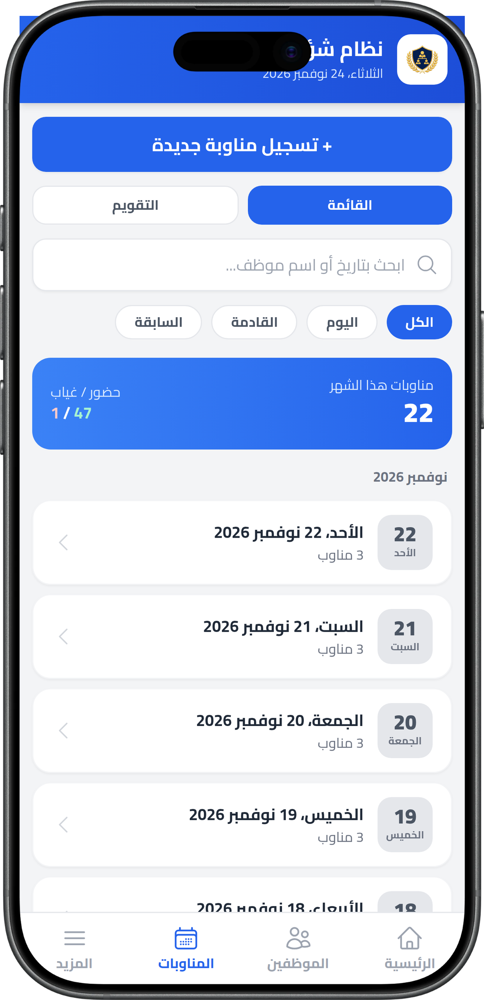

### Shifts — smart calendar view

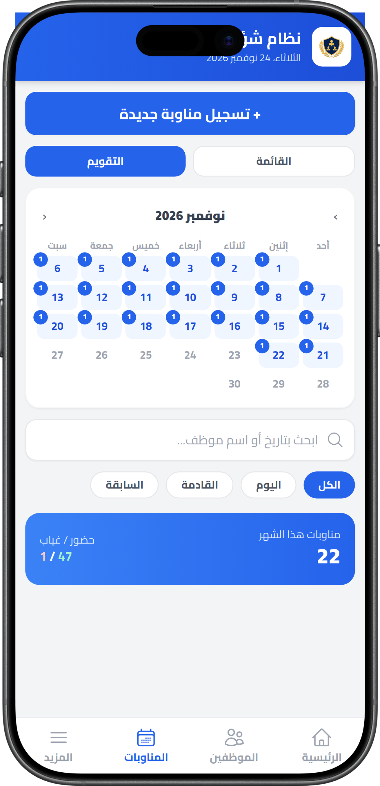

### More — sync status and all sections

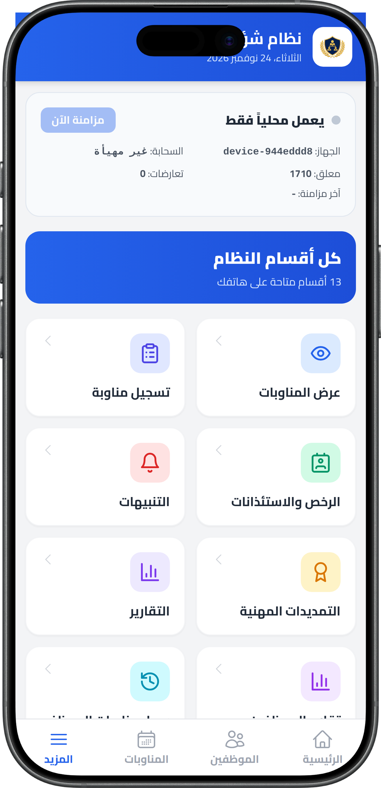

> The screenshots are from the real application while running, seeded with the fictional showcase dataset — every name and record shown is invented.

## Tech Stack

- **Frontend** — React + Vite + TypeScript, Cairo font, full Arabic RTL
- **Backend** — Express (Node.js) with REST APIs
- **Database** — SQLite (a single local file for master data and transactions)
- **Desktop** — an Electron shell for an installable version, alongside the web version

## Architecture

A modular single-deployment application: a React frontend organised by domain modules (employees, shifts, licenses, parking, reports), a thin Express API layer, and a single SQLite database. Audit-log middleware wraps every write operation, which is what feeds the activity screen on the dashboard. The duty queue is computed from the duty history at read time, so it stays always up to date without separate scheduled jobs. The `licenses system` folder contains an older standalone version of the licenses module with a JSON store.

## Running Locally

```bash
npm install
npm run dev          # frontend on port 5180
npm run backend      # server (Express + SQLite)
```

## Status

Showcase copy for a professional portfolio. The original system is in daily internal use; this public copy contains the code after sanitisation and fictional data only.
